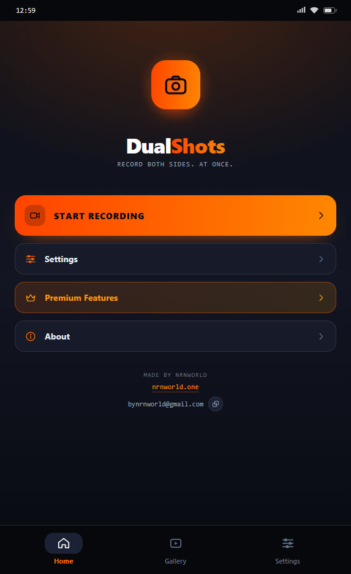
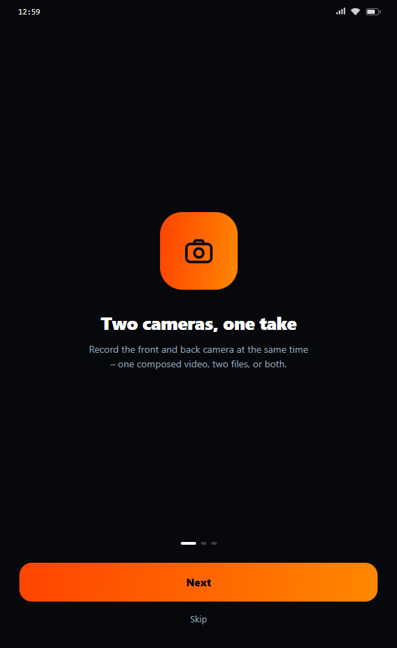
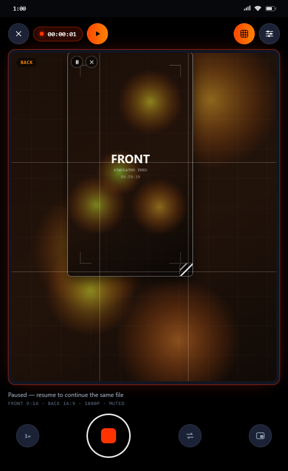
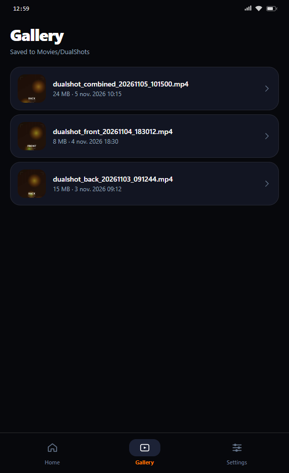
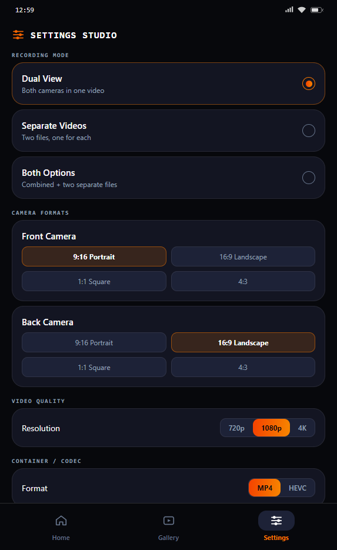

# ⚔️ DualShots

**Capture more. From every angle.**

DualShots is a native Android camera app that records from the **front and back cameras simultaneously**. Choose a single composed video, two independent files, or both at once — with per-camera format controls, in-take pause and a freemium premium tier.

Built with **Kotlin**, **Jetpack Compose**, and the **CameraX Dual Concurrent Camera** API.

---

## 📸 Screenshots

<table>
  <tr>
    <td align="center"><b>Home</b><br/></td>
    <td align="center"><b>Onboarding</b><br/></td>
    <td align="center"><b>Record</b><br/></td>
  </tr>
  <tr>
    <td align="center"><b>Gallery</b><br/></td>
    <td align="center"><b>Settings</b><br/></td>
    <td align="center"></td>
  </tr>
</table>

<sub>The screenshots are rendered by [`web/`](web), the browser preview that mirrors the Compose UI with the same design tokens.</sub>

---

## ✨ Features

### Dual-camera recording
- **Simultaneous front + back recording** (device-dependent).
- **Three recording modes**:
  - **Dual View** — both cameras composed into **one** MP4 (picture-in-picture).
  - **Separate Videos** — **two** files, one per camera.
  - **Both Options** — the composed video **plus** the two separate files.
- **Per-camera format control** — set the aspect ratio for the front and back camera independently (e.g. front 9:16, back 16:9).
- **Robust fallback** — if a device does not support concurrent cameras, the app degrades to a working single-camera mode so you can always record.

### Recording controls
- **Pause and resume inside the same file** — the timer freezes and the take continues in one MP4 instead of starting a new clip.
- **One take = one file** — layout, quality and camera changes made mid-take are applied to the *next* take, never by splitting the current recording.
- **Movable small camera** — drag the overlay anywhere, resize it with the corner handle, double-tap to reset, or pause / close it mid-take.
- **Pinch to zoom each camera** independently, with an on-screen zoom label.
- **3×3 grid** for framing.
- **Tap to focus** with AF/AE metering and a focus ring.
- **Haptics** on record, pause, swap, grid and gallery actions.
- **Screen stays awake** while recording, and a **low-storage guard** blocks a take when free space is critically low.

### Gallery
- Clips are saved to `Movies/DualShots` via `MediaStore` (older recordings in `Movies/DuelShots` are still listed).
- **Thumbnails** for every take (API 29+), size and timestamp in the row.
- **In-app player** plus **share** and **delete** with a confirmation dialog.

### First run
- **Permission screen** with a clear rationale, a retry action and a direct jump to system settings.
- **Three-step onboarding** that explains dual capture, the small camera and the gallery.
- **Adaptive launcher icon** (API 26/33, with a themed monochrome layer) and a **branded splash**.

### Design
- Modern dark studio design system with a custom orange gradient logo, Compose Material 3 theming and monospaced accents.

## 🧩 Recording modes at a glance

| Mode | Output | Notes |
|------|--------|-------|
| Dual View | 1 composed MP4 | Uses CameraX composition; PiP layout |
| Separate Videos | 2 MP4 files | One per camera |
| Both Options | 3 MP4 files | Composed + two separate |

## 🛠 Tech stack

- **Language:** Kotlin
- **UI:** Jetpack Compose + Material 3
- **Camera:** CameraX 1.5.0 (Dual Concurrent Camera + VideoCapture)
- **Storage:** MediaStore (`MediaStoreOutputOptions`)
- **Preferences:** SharedPreferences
- **Architecture:** ViewModel + lightweight controller layer
- **Build:** Gradle (AGP 8.7.3, Kotlin 2.0.21, Compose BOM 2024.09.03)

## 📱 Requirements

- **Android:** `minSdk 24` (Android 7.0+), `targetSdk 34`
- **JDK:** 17 or 21 for building (21 recommended)
- **Dual-camera recording** requires a device whose camera HAL supports concurrent camera streams. Many devices do not — the app then falls back to single-camera mode automatically.

## 🖥️ Web preview (no Android SDK needed)

Want to click through the app right away? A dependency-free browser replica lives in
[`web/`](web) — same screens, same design tokens, same three recording modes, with the
recording pipeline reimplemented on `getUserMedia` + `MediaRecorder`:

```bash
python3 -m http.server 8000 --directory web
# open http://localhost:8000
```

It records real (downloadable) clips into the Gallery, persists settings in
`localStorage`, and falls back to a single camera — or an animated demo feed — when the
browser cannot open both cameras. The preview mirrors the app's own interface: the orange
app tile and *DualShots* wordmark, the four-row home menu, the three-tab bottom bar, the
Settings studio with mode radios and inline quality controls, the Gallery with thumbnails
and the Share / Delete / Close player dialog, and the PRO dialog. It also mirrors the
record screen's pause-in-one-file behaviour, the pause / close controls on the small
camera and the 3×3 grid. On the first visit the same three-step onboarding is shown. See
[`web/README.md`](web/README.md) for the screen-by-screen mapping.

## 🚀 Getting started

### Build from source

```bash
git clone https://github.com/nRn-World/DualShots.git
cd DualShots

# Point Gradle at your SDK (or set ANDROID_HOME)
echo "sdk.dir=/path/to/Android/sdk" > local.properties

# Build the debug APK
./gradlew :app:assembleDebug
```

The APK is produced at:

```
app/build/outputs/apk/debug/app-debug.apk
```

### Install on a device

```bash
adb install -r app/build/outputs/apk/debug/app-debug.apk
```

> **Note:** The Android emulator does not support concurrent dual-camera. Use it to validate the UI and single-camera recording; test true dual-camera capture on a physical device.

## 🔐 Permissions

- `CAMERA` — required for recording.
- `RECORD_AUDIO` — required for audio in recordings.

The app asks for both once, explains why on its own permission screen, and offers a
one-tap jump to system settings if they were permanently denied.

## 💎 Premium

The premium tier is a design-ready monetization layer. In this build the purchase is **mocked** (`grantPremium()`); wire it to **Google Play Billing** before release. Premium is presented as:

- 4K Ultra HD recording
- HEVC codec
- 60fps & custom bitrate
- Full per-camera aspect control
- Watermark-free export *(no watermark is burned into the file yet — the renderer is not wired up)*

## 📂 Project structure

```
DualShots/
├── app/src/main/java/com/nrworld/duelshot/
│   ├── MainActivity.kt              # Entry point, permissions, onboarding gate
│   ├── camera/DualCameraController.kt  # CameraX binding, pause/resume, focus, 3 modes
│   ├── data/AppPrefs.kt             # SharedPreferences wrapper
│   ├── model/Models.kt              # Enums: modes, aspect, quality, codec
│   └── ui/
│       ├── AppViewModel.kt          # Observable settings state
│       ├── DualShotsApp.kt          # Navigation shell + bottom bar
│       ├── components/Components.kt # Buttons, cards, dialogs, icons
│       ├── theme/                   # Color, Type, Theme
│       ├── home/HomeScreen.kt
│       ├── onboarding/OnboardingScreen.kt
│       ├── record/RecordScreen.kt
│       ├── settings/SettingsScreen.kt
│       └── gallery/GalleryScreen.kt
├── screenshots/                     # README images
├── design/                          # Design poster & mockups
└── build.gradle.kts / settings.gradle.kts
```

## 🗺 Roadmap

- [x] Pause / resume inside a single file
- [x] 3×3 grid, tap-to-focus and haptics
- [x] In-app gallery player with share and delete
- [x] First-run onboarding and adaptive icon
- [ ] Real Google Play Billing integration
- [ ] Watermark renderer for free exports
- [ ] Full string localization (i18n)
- [ ] Quick Settings tile to start a take
- [ ] In-app video trimmer & export presets
- [ ] Configurable picture-in-picture layout for Dual View

## 🤝 Contributing

Issues and pull requests are welcome. For larger changes, please open an issue first to discuss what you would like to change.

## 📄 License

Distributed under the **MIT License**. See [`LICENSE`](LICENSE) for more information.

---

Made by **nRnWorld** — [nrnworld.one](https://nrnworld.one) · bynrnworld@gmail.com
